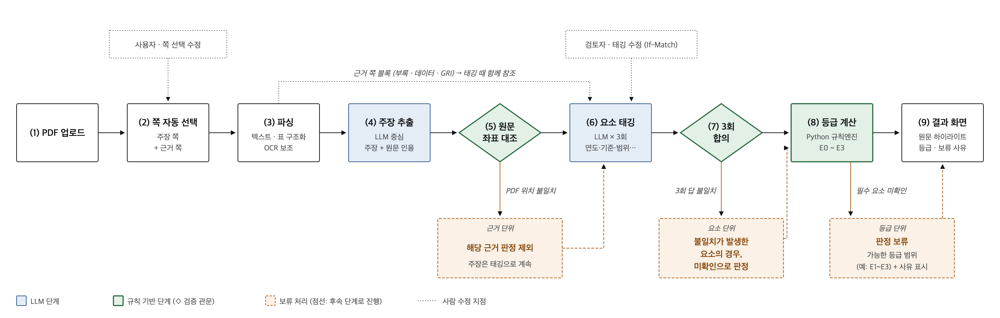
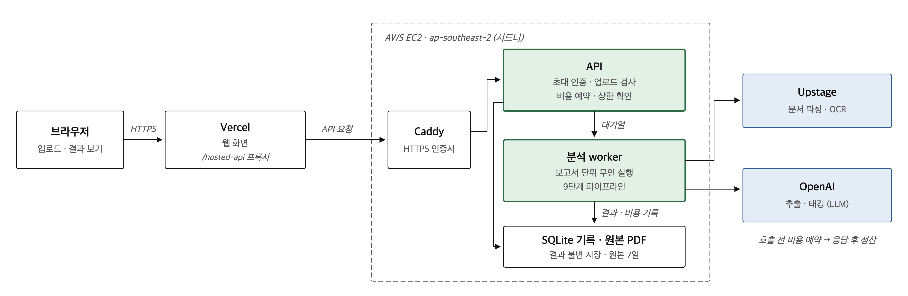

# ESG ProofOps — 공시 문장의 원문 근거 점검

지속가능성 공시 PDF에서 환경 주장을 찾아 **같은 공시의 원문 근거로 어디까지 확인할 수 있는지** E0–E3와 보류 사유로 보여줍니다. 기업의 실제 성과·진위·그린워싱·위법 여부를 판정하거나 법적 면책을 보장하지 않습니다.

이 저장소는 **분석 서버·파이프라인 제출물**입니다. 공개 웹은 별도 웹 제출물에서 배포합니다. [웹 서비스](https://esg-proofops.vercel.app)의 `/demo`에서 저장 사례를 보고, `/analyze`에서 초대 로그인 후 보고서를 접수합니다. 새 분석은 비용이 발생하며 서버의 접수·예산 상태에 따릅니다.

최종 v29d + FX4의 후속 승인·배포·롤백·재사용 계약은 [개발 인수인계](docs/HANDOFF.md)를 먼저 읽습니다. 초기 명세와 달라진 DEC-125/127/154의 적용 범위도 이 문서에 명시했습니다.

빠른 읽기: 아래 9단계 → 원문·판정 원칙 → 실행 방법 → 측정과 한계 순서로 확인하면 전체 흐름을 볼 수 있습니다. 도메인 정본은 [원문 v2](sources/PROJECT_DOMAIN_V2_ORIGINAL.md), 구현 계약은 [Master](docs/00_MASTER_SPEC.md)입니다.

## 9단계 파이프라인



| 단계 | 처리와 산출물 |
| --- | --- |
| 1. PDF 업로드 | 인증·문서 권리·파일 보안 검사를 거쳐 원본 해시와 문서 버전을 고정합니다. |
| 2. 쪽 자동 선택 | 주장 쪽과 근거 검색 쪽을 구분해 제안하고 사용자가 범위·보고기간을 확인합니다. |
| 3. 파싱 | 문단·표·OCR을 구조화하고 물리 쪽번호·좌표·원문 출처를 보존합니다. |
| 4. 주장 추출 | LLM이 환경 문장을 원자 주장과 인용 후보로 분리합니다. |
| 5. 원문 좌표 대조 | 인용·문자 구간·표 행/셀·좌표를 원본과 검증합니다. 미검증 후보는 판정 근거에서 제외합니다. |
| 6. 요소 태깅 | 같은 고정 근거 패킷을 읽는 독립 replica 3회가 연도·수치·방법·범위·보증 등을 태깅합니다. |
| 7. 3회 합의 | 요소별 반복 판독 결과를 확인합니다. 완료된 3회 중 요소 2/3의 검증된 합의를 허용하며 유형은 3/3을 유지합니다. 충돌·판독 불가·미완료는 보류합니다. |
| 8. 등급 계산 | 순수 Python 규칙엔진이 승인된 트랙별 사다리를 적용합니다. 미해결 입력·규칙은 보류/가능 범위로 남깁니다. |
| 9. 결과 화면 | 주장·근거·검증된 원문 위치·잠정/확정 등급·보류 사유와 검토 이력을 제공합니다. |

## 판정에서 지키는 원칙

- **LLM은 추출·태깅만 수행합니다.** E0–E3와 라벨 계산은 Python 규칙엔진의 책임입니다. E3는 `SUBSTANTIATED`, E1/E2는 `INCOMPLETE`, E0는 `UNSUBSTANTIATED`이며 보류는 E0가 아닙니다.
- **범위 내 부재와 문서 전체 부재를 구분합니다.** DEC-127 승인으로 3회 태깅 완료 후 분석한 쪽 안에서 검증·연결하지 못한 요소는 `absent_in_scope`가 됩니다. `conflict`·`unreadable`·TIME_BUDGET 미처리는 이 전환 대상이 아닙니다. 검증된 원문 인용과 해당 주장에 대한 귀속이 없으면 `present`로 인정하지 않습니다.
- **숫자·목표연도는 해당 주장/동일 표의 직접 근거를 확인합니다.** 방법론·범위·보증의 전역 근거를 모든 요소로 확대하지 않습니다. DEC-93의 기준연도·기준값 연결은 동일 주체·지표·단위·경계와 검증 원문이 일치하는 제한적 예외입니다.
- **위치 확인은 진위나 등급 확정이 아닙니다.** 원문 쪽 이미지에는 검증된 좌표만 표시하고 미검증 ref는 그대로 알립니다. [파싱·근거 계약](docs/27_PARSING_AND_PROVENANCE.md) · [원문 읽기 API](docs/hosted-read-api.md)
- **3회 태깅의 replica를 유지합니다.** 동일 캐시 응답을 3회 합의로 세지 않습니다. 합의가 있어도 원문·귀속·규칙 게이트를 통과해야 합니다.
- **기록은 불변입니다.** 테넌트·문서 버전·모델/프롬프트/규칙 해시를 보존합니다. 사람은 태그를 수정하고 `If-Match`로 충돌을 막으며 새 revision을 만듭니다. [규칙 계약](docs/28_RULE_ENGINE_CONTRACT.md) · [미정 도메인](docs/31_DOMAIN_IMPLEMENTATION_GAPS.md)

## 현재 제출 경로의 시스템 구성



`브라우저 → Vercel 웹 /hosted-api → EC2 시드니(ap-southeast-2) Caddy → FastAPI → 작업 대기열/worker → Upstage 파싱·OCR / OpenAI 추출·태깅` 구조입니다. 서버는 SQLite와 비공개 로컬 파일로 원본·체크포인트·비용 영수증을 보관합니다. 설계 문서의 다른 AWS 서비스 구성은 이 hosted 경로의 배포 완료를 의미하지 않습니다.

Hosted 비용은 **실행 USD1·일 USD7 코드 상한**이며 더 낮은 운영 설정이 우선합니다. 행사 상한과 승인 ceiling은 별도 운영 설정입니다. 전송 전에 비용을 예약하고 응답 후 정산합니다. 미정산·불확실한 호출의 예약을 지우거나 자동 재전송하지 않습니다. 원본은 기본 7일 보관하며 삭제·권한·원문 무결성 가드를 유지합니다. 이 상한은 모델 처리 비용 가드이며 EC2/Vercel 전체 청구 상한은 아닙니다. [Hosted 계약](deploy/public/CONTRACT.md)

## 디렉터리 안내

| 경로 | 먼저 볼 내용 |
| --- | --- |
| [packages/proofops/domain](packages/proofops/domain) | 네트워크·AWS SDK와 분리된 판정/근거 도메인 |
| [packages/proofops/application](packages/proofops/application) | 실행·근거 검색·합의·규칙 적용 orchestration |
| [packages/proofops/adapters](packages/proofops/adapters) | 파서·OCR·저장소·공급자 연결 |
| [apps/api](apps/api) · [apps/worker](apps/worker) · [apps/agent](apps/agent) | HTTP/인증·작업 처리·모델 태깅 실행 경계 |
| [apps/web](apps/web) | 서버와 함께 보존하는 웹 개발 코드; 공개 웹 배포는 별도 제출물 |
| [evaluation](evaluation) · [tests](tests) | 평가·재생 도구와 unit/integration/contract/security 검사 |
| [contracts](contracts) · [config](config) | 기계 판독 계약·고정 규칙/정책 |
| [deploy/ec2](deploy/ec2) · [deploy/public](deploy/public) | 배포 키트·runtime 템플릿·운영/rollback 계약 |

## 로컬에서 보기와 검사

Python 3.12와 `uv`를 사용합니다. 파싱·원문 재생에는 해당 정책이 요구하는 Java 21·PDF/OCR 런타임도 필요합니다. [서버 이미지의 고정 의존성](deploy/public/Dockerfile)을 기준으로 맞추며 원문 검증을 우회하지 않습니다.

```bash
uv sync --locked
uv run python scripts/submission_demo.py --help
uv run python scripts/analyze_report.py --help
```

권리가 확인된 저장 상태(`pilot.json` 포함)가 있을 때 아래 명령으로 **읽기 전용 로컬 검토 화면**을 엽니다. 원본 PDF와 저장 상태는 제출 저장소에 포함하지 않습니다. 초기 복사/재생이 필요하고 실행기는 원본 상태를 덮어쓰지 않습니다. 추가 모델 호출을 켜는 `--invoke`/`--serve-worker`를 붙이지 않습니다.

```bash
uv run python scripts/submission_demo.py --seed /path/to/saved-pilot-state --port 8790
```

새 PDF의 입력 계획만 확인하려면 다음을 사용합니다. 파일·물리 쪽·보고기간은 해당 문서에 맞게 바꿉니다. 유료 실행은 별도 승인과 기존 예산 장부가 필요하며 이 명령에는 `--invoke`가 없습니다. [로컬 실행 세부사항](docs/SUBMISSION_DEMO.md)

```bash
uv run python scripts/analyze_report.py --pdf /path/to/report.pdf   --pages 25,117,138 --claim-pages 25 --report-year 2025   --period-start 2025-01-01 --period-end 2025-12-31
```

다음은 순수 규칙 및 합성 입력을 사용하는 hosted 경계 검사입니다. 테스트 통과 수를 모델 정확도로 해석하지 않습니다. 통합/릴리스에서는 [Hosted 계약](deploy/public/CONTRACT.md)의 호환성·보안·회계 조건과 변경 범위의 검사를 확인합니다. 실제 외부 호출을 하지 않은 항목은 `not_run`으로 남깁니다.

```bash
uv run pytest tests/acceptance/test_rules.py tests/test_hosted_public.py tests/test_pa6_reads.py -q
uv run ruff check packages/proofops/domain
```

웹은 별도 제출물 README의 `pnpm` 실행/검사 안내를 따릅니다. 기존 원문·태깅·판정·비용 장부의 불변 기록을 유지하며 예산을 새 장부로 초기화하지 않습니다.

## 배포와 운영 — 조정자 전용

**EC2 설정·컨테이너·compose override 변경은 조정자만 수행합니다.** 다른 작업자는 필요한 변경을 보고서의 요청으로 남깁니다. 키·초대 코드·계정 식별자·호스트·개인 이메일은 문서에 기록하지 않고 비공개 운영 파일로 공급합니다. [운영 runbook](deploy/public/RUNBOOK.md) · [EC2 키트](deploy/ec2)

다음은 서버에 이미 설치된 release에서 조정자가 수행하는 절차입니다. `drain`은 새 실행 접수/대기열 claim을 닫고 진행 중 실행은 유지합니다. 기존 대기열·예약·결과는 지우지 않습니다.

```bash
cd /srv/proofops
sudo docker compose --env-file compose.env -f compose.yaml exec -T api python scripts/hosted_control.py drain
sudo docker compose --env-file compose.env -f compose.yaml exec -T api python scripts/hosted_control.py wait-idle --timeout 600
```

`wait-idle`의 timeout 종료 코드는 3이며 실패하면 drain을 유지합니다. 조정자가 새 release/설정을 적용하고 API health 및 `/v1/health/ready`를 확인한 뒤 재개합니다. 이전 정책·체크포인트·회계/삭제 장부를 보존하는 rollback 조건은 [Hosted 계약](deploy/public/CONTRACT.md)을 따릅니다.

```bash
sudo docker compose --env-file compose.env -f compose.yaml exec -T api python scripts/hosted_control.py resume
```

`resume`은 drain 플래그만 해제하며 꺼져 있는 접수나 비용 상한을 덮어쓰지 않습니다. 이 README 정리에서는 운영 명령을 실행하지 않았습니다.

## 현재 한계와 공개 checkout

v29d + FX4의 처리 구조, TIME_BUDGET, 일일 USD7 코드 상한, DEC-154 원격 근거 미통합,
DEC-127 과소등급 위험과 RC1 호환성 한계는 [인수인계](docs/HANDOFF.md)에 정리했습니다.
모의·재생 테스트를 실모델 정확도나 서버 wire 검증으로 표현하지 않습니다.

내부 보고서·결정 로그·평가 원시자료·개인 경로는 공개 release에서 제외합니다.
CI2에서 정리한 공개 발췌/합성 회귀 fixture와 이식 가능한 CI 환경을 유지합니다.
공개 계정 자리표시자는 실제 계정 일치 가드를 통과하지 못합니다. 배포 전 승인된 비공개 사본에서
계정 핀과 기존 SSM 설정, 동시성/RPS 16/8, timeout 2700초와 API1536MiB override를 확인합니다.
실제 모델·AWS 시험 및 배포는 이 공개 준비 범위에 포함되지 않습니다.
